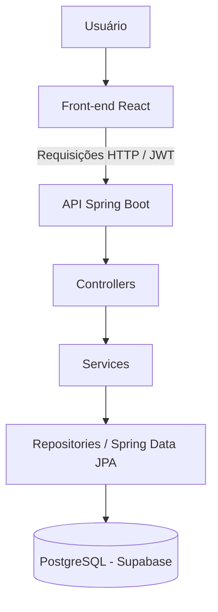

# 🚗 Deu Partida

> Sistema web para gerenciamento de aluguéis de automóveis, conectando clientes e agentes em um fluxo de solicitação, análise financeira e acompanhamento de pedidos.

<div align="center">
  
</div>

<div align="center">


</div>

---

## 📚 Índice

- [Sobre o Projeto](#-sobre-o-projeto)
- [Funcionalidades](#-funcionalidades)
- [Tecnologias](#-tecnologias)
- [Arquitetura](#-arquitetura)
- [Documentação e Modelagem](#-documentação-e-modelagem)
- [Instalação e Execução](#-instalação-e-execução)
  - [Pré-requisitos](#pré-requisitos)
  - [Clonar o Repositório](#1-clonar-o-repositório)
  - [Configurar o Banco de Dados](#2-configurar-o-banco-de-dados)
  - [Configurar as Variáveis de Ambiente](#3-configurar-as-variáveis-de-ambiente)
  - [Instalar as Dependências](#4-instalar-as-dependências)
  - [Executar a Aplicação](#5-executar-a-aplicação)
- [Estrutura do Projeto](#-estrutura-do-projeto)
- [Comandos Úteis](#-comandos-úteis)
- [Autor](#-autor)

---

## 📝 Sobre o Projeto

O **Deu Partida** é uma aplicação web desenvolvida no Laboratório 02 da disciplina de **Desenvolvimento e Integração de Aplicações Web (DIAW)**, do curso de Engenharia de Software da PUC Minas.

A aplicação organiza o processo de aluguel de automóveis em uma plataforma na qual clientes podem cadastrar seus dados, solicitar aluguéis e acompanhar o andamento dos pedidos. Agentes vinculados a empresas ou bancos podem consultar os pedidos recebidos e realizar a análise financeira.

O sistema também contempla o cadastro de automóveis, rendimentos dos clientes e a associação opcional de um banco a uma solicitação de aluguel.

## ✨ Funcionalidades

### 👤 Clientes

- Cadastro e autenticação de usuários.
- Consulta e atualização dos próprios dados cadastrais.
- Registro de profissão e rendimentos.
- Criação de pedidos de aluguel.
- Consulta dos próprios pedidos e seus respectivos status.
- Consulta dos detalhes de um pedido.
- Edição e cancelamento de pedidos conforme as regras de negócio.

### 🏢 Agentes

- Cadastro e autenticação de agentes.
- Consulta dos pedidos recebidos.
- Avaliação financeira de pedidos.
- Consulta e gerenciamento dos automóveis vinculados ao agente.

### 🚘 Pedidos e contratos

- Associação de um automóvel a uma solicitação de aluguel.
- Definição do período desejado para o aluguel.
- Associação opcional de um banco para contratação de crédito.
- Acompanhamento do status da solicitação.
- Registro da avaliação financeira e dos contratos relacionados ao pedido.

## 🛠 Tecnologias

### Front-end

| Tecnologia | Utilização |
| :--- | :--- |
| [React 19](https://react.dev/) | Construção da interface por componentes. |
| [TypeScript](https://www.typescriptlang.org/) | Tipagem estática do código. |
| [Vite 8](https://vite.dev/) | Ambiente de desenvolvimento e build. |
| [React Router](https://reactrouter.com/) | Navegação e controle de rotas. |
| [Axios](https://axios-http.com/) | Comunicação HTTP com a API. |
| CSS | Estilização da aplicação. |
| [ESLint](https://eslint.org/) | Análise estática e padronização do código. |

### Back-end

| Tecnologia | Utilização |
| :--- | :--- |
| [Java 25](https://www.oracle.com/java/) | Linguagem de programação. |
| [Spring Boot 4.1.2](https://spring.io/projects/spring-boot) | Estrutura principal da aplicação e API REST. |
| Spring Web MVC | Criação dos endpoints HTTP. |
| Spring Data JPA | Persistência e consultas ao banco de dados. |
| Spring Security | Autenticação e autorização. |
| [JJWT](https://github.com/jwtk/jjwt) | Geração e validação de tokens JWT. |
| Hibernate | Mapeamento objeto-relacional. |
| [Maven](https://maven.apache.org/) | Gerenciamento de dependências e build. |
| Lombok | Redução de código repetitivo nas classes Java. |

### Banco de Dados

- **[Supabase](https://supabase.com/):** serviço utilizado para hospedar o banco de dados.
- **PostgreSQL:** sistema gerenciador de banco de dados relacional.
- **JDBC:** conexão entre a aplicação Spring Boot e o PostgreSQL.

---

## 🏗 Arquitetura

O projeto utiliza uma arquitetura cliente-servidor. O front-end, desenvolvido com React, consome os endpoints REST disponibilizados pelo back-end Spring Boot. O back-end concentra as regras de negócio, a autenticação e o acesso aos dados persistidos no PostgreSQL.

### Organização do back-end

O back-end segue a organização em camadas, dentro do padrão MVC:

| Camada | Responsabilidade |
| :--- | :--- |
| **Controller** | Recebe as requisições HTTP e disponibiliza os endpoints da API. |
| **Service** | Implementa as regras de negócio e coordena as operações. |
| **Repository** | Realiza o acesso e a persistência dos dados com Spring Data JPA. |
| **Model** | Representa as entidades e os conceitos do domínio. |
| **DTO** | Define os dados recebidos e enviados pela API. |
| **Security** | Configura autenticação, autorização e validação dos tokens JWT. |
| **Config** | Reúne configurações da aplicação, como CORS. |

### Autenticação e autorização

A autenticação utiliza **JWT**. Após o login, a API retorna um token que o front-end armazena e envia no cabeçalho `Authorization` das requisições protegidas.

O sistema diferencia os perfis `CLIENTE` e `AGENTE`, restringindo o acesso às funcionalidades de acordo com o perfil autenticado. No front-end, as rotas privadas também verificam a autenticação e o perfil do usuário.

### Fluxo simplificado



---

## 📐 Documentação e Modelagem

Os documentos de análise e modelagem estão versionados no diretório [`docs/`](./docs).

### Diagramas UML

| Documento | Arquivo |
| :--- | :--- |
| Diagrama de casos de uso | [Visualizar diagrama](./docs/diagramas/casos-de-uso.png) |
| Diagrama de classes | [Visualizar diagrama](./docs/diagramas/diagrama-classes.png) |
| Diagrama de pacotes | [Visualizar diagrama](./docs/diagramas/diagrama-pacotes.png) |
| Histórias de usuário | [Visualizar documento](./docs/historias-de-usuario.md) |

### Wireframes

Os wireframes das telas planejadas estão disponíveis em [`docs/wireframe/`](./docs/wireframe):

- [Meu cadastro de cliente](./docs/wireframe/01_meu_cadastro_cliente.png)
- [Criar conta de agente](./docs/wireframe/02_criar_conta_agente.png)
- [Pedidos recebidos](./docs/wireframe/03_pedidos_recebidos.png)
- [Meus automóveis](./docs/wireframe/04_meus_automoveis.png)
- [Criar conta de cliente](./docs/wireframe/05_criar_conta_cliente.png)
- [Solicitar aluguel](./docs/wireframe/06_solicitar_aluguel.png)
- [Login](./docs/wireframe/07_login.png)
- [Meus pedidos](./docs/wireframe/08_meus_pedidos.png)

---

## 🔧 Instalação e Execução

### Pré-requisitos

Antes de executar o projeto, instale:

- **Java JDK 25**
- **Node.js** (versão compatível com o Vite utilizado no projeto) e npm
- **Git**
- Uma conta no **Supabase** com um projeto PostgreSQL criado

### 1. Clonar o Repositório

```bash
git clone https://github.com/TaroNukem/Deu-Partida.git
cd Deu-Partida
```

### 2. Configurar o Banco de Dados

O projeto utiliza um banco PostgreSQL hospedado no Supabase.

1. Acesse [supabase.com](https://supabase.com/) e crie um projeto.
2. No painel do projeto, abra a opção **Connect**.
3. Selecione o método de conexão **Session Pooler**.
4. Copie os dados de conexão fornecidos pelo Supabase.
5. Utilize esses dados para preencher as variáveis do back-end na próxima etapa.

> O endereço JDBC deve seguir o formato `jdbc:postgresql://HOST:PORTA/postgres?sslmode=require`. Utilize o host, a porta e o usuário exibidos para o Session Pooler no painel do seu projeto.

### 3. Configurar as Variáveis de Ambiente

#### Back-end

Na pasta `backend`, existe o arquivo [`env.example`](./backend/env.example) com o modelo das variáveis necessárias.

Crie uma cópia com o nome `.env`:

**Windows PowerShell**
```powershell
Copy-Item env.example .env
```

**Linux / macOS**
```bash
cp env.example .env
```

Preencha o arquivo `backend/.env` com os dados do seu projeto:

| Variável | Descrição |
| :--- | :--- |
| `DB_URL` | URL JDBC de conexão com o PostgreSQL do Supabase. |
| `DB_USER` | Usuário disponibilizado pelo Session Pooler. |
| `DB_PASSWORD` | Senha do banco de dados definida no Supabase. |
| `JWT_SECRET` | Segredo utilizado para assinar os tokens JWT. |
| `FRONTEND_ORIGIN` | Origem permitida para comunicação com o front-end. |

Exemplo de estrutura:

```env
DB_URL=jdbc:postgresql://HOST:PORTA/postgres?sslmode=require
DB_USER=USUARIO_DO_SESSION_POOLER
DB_PASSWORD=SUA_SENHA
JWT_SECRET=uma-chave-secreta-com-pelo-menos-32-caracteres
FRONTEND_ORIGIN=http://localhost:5173
```

O arquivo `application.properties` importa opcionalmente o `.env` localizado no diretório de execução do back-end. Por isso, execute os comandos do back-end a partir da pasta `backend`.

#### Front-end

Na pasta `frontend`, copie [`frontend/.env.example`](./frontend/.env.example) para `frontend/.env`:

**Windows PowerShell**
```powershell
Copy-Item .env.example .env
```

**Linux / macOS**
```bash
cp .env.example .env
```

A variável disponível é:

| Variável | Descrição | Valor local |
| :--- | :--- | :--- |
| `VITE_API_URL` | Endereço base da API do back-end. | `http://localhost:8080` |

> [!WARNING]
> Não compartilhe nem versione os arquivos `.env`. Eles contêm credenciais e informações privadas. Utilize os arquivos de exemplo para documentar as variáveis necessárias, nunca as senhas reais.

### 4. Instalar as Dependências

Abra um terminal na raiz do repositório.

#### Front-end

```bash
cd frontend
npm install
```

#### Back-end

Em outro terminal:

**Windows PowerShell**
```powershell
cd backend
.\mvnw.cmd clean install
```

**Linux / macOS**
```bash
cd backend
./mvnw clean install
```

### 5. Executar a Aplicação

O front-end e o back-end devem ser iniciados separadamente.

#### Terminal 1 — Back-end

A partir da pasta `backend`:

**Windows PowerShell**
```powershell
.\mvnw.cmd spring-boot:run
```

**Linux / macOS**
```bash
./mvnw spring-boot:run
```

A API ficará disponível em:

`http://localhost:8080`

#### Terminal 2 — Front-end

A partir da pasta `frontend`:

```bash
npm run dev
```

O Vite exibirá no terminal o endereço local da aplicação. Por padrão:

`http://localhost:5173`

---

## 📂 Estrutura do Projeto

Estrutura resumida dos diretórios e arquivos relevantes do repositório:

```text
Deu-Partida/
├── README.md
├── docs/
│   ├── diagramas/
│   │   ├── casos-de-uso.png
│   │   ├── diagrama-classes.png
│   │   └── diagrama-pacotes.png
│   ├── wireframe/
│   │   ├── 01_meu_cadastro_cliente.png
│   │   ├── 02_criar_conta_agente.png
│   │   ├── 03_pedidos_recebidos.png
│   │   ├── 04_meus_automoveis.png
│   │   ├── 05_criar_conta_cliente.png
│   │   ├── 06_solicitar_aluguel.png
│   │   ├── 07_login.png
│   │   └── 08_meus_pedidos.png
│   └── historias-de-usuario.md
│
├── frontend/
│   ├── .env.example
│   ├── package.json
│   └── src/
│       ├── assets/
│       ├── components/
│       ├── context/
│       ├── pages/
│       ├── routes/
│       ├── services/
│       ├── types/
│       └── utils/
│
└── backend/
    ├── env.example
    ├── mvnw
    ├── mvnw.cmd
    ├── pom.xml
    └── src/
        ├── main/
        │   ├── java/com/aluguel/aluguelcarros/
        │   │   ├── config/
        │   │   ├── controller/
        │   │   ├── dto/
        │   │   ├── exception/
        │   │   ├── model/
        │   │   ├── repository/
        │   │   ├── security/
        │   │   ├── service/
        │   │   └── util/
        │   └── resources/
        │       └── application.properties
        └── test/
            └── java/com/aluguel/aluguelcarros/
```

## 🧪 Comandos Úteis

### Front-end

| Comando | Ação |
| :--- | :--- |
| `npm run dev` | Inicia o servidor de desenvolvimento. |
| `npm run build` | Verifica os tipos TypeScript e gera o build de produção. |
| `npm run lint` | Executa o ESLint. |
| `npm run preview` | Executa uma prévia local do build. |

### Back-end

Execute os comandos dentro da pasta `backend`:

| Comando | Ação |
| :--- | :--- |
| `./mvnw spring-boot:run` | Inicia a aplicação Spring Boot. |
| `./mvnw clean install` | Limpa, compila e empacota o projeto. |
| `./mvnw test` | Executa os testes automatizados. |
| `./mvnw clean package` | Gera o pacote JAR de produção. |

No Windows, substitua `./mvnw` por `.\mvnw.cmd`.

---

## 👨‍💻 Autor

<div align="center">

**Daniel Gomes Rolando**

[](https://github.com/TaroNukem)
[](https://www.linkedin.com/in/daniel-gomes-rolando)

</div>

---

<div align="center">
  Desenvolvido como parte do Laboratório 02 de Desenvolvimento e Integração de Aplicações Web — PUC Minas.
</div>
